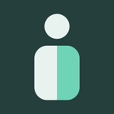
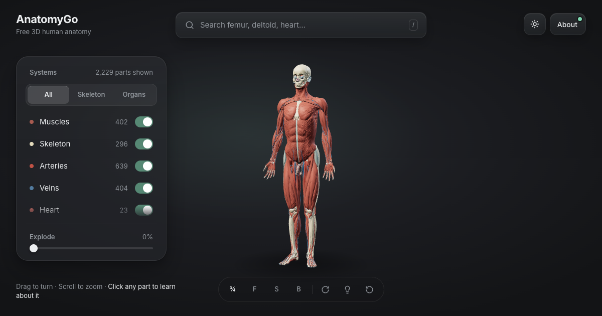
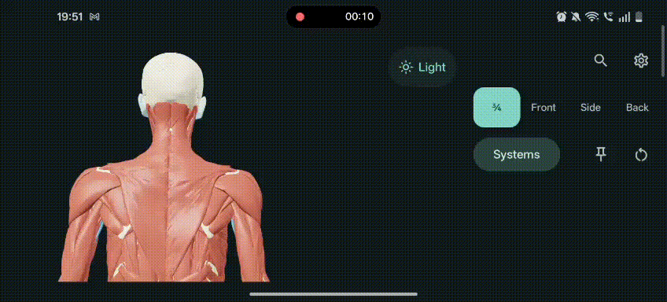

<div align="center">



# AnatomyGo

**Explore the human body in 3D, for free, in your browser or on Android.**

[](https://anatomygo.in) [](https://play.google.com/store/apps/details?id=com.anatomygo) [](https://opencollective.com/anatomygo)



</div>

## What you can do

- **Explore 2,234 pieces in 15 systems.** Rotate, zoom and tap any structure to see what it is.
- **Search, isolate and explode** the body to see where each part sits and what surrounds it.
- **Open shared views** with study pins, and reveal answers quiz-style.
- **Pin parts and features** right on the model, and vote on or comment on other people's pins.

No account is needed. It works on phones, tablets and computers.

## Get AnatomyGo

- 🌐 **Web:** [anatomygo.in](https://anatomygo.in), in any modern browser, including iPhone and iPad.
- 🤖 **Android:** [Google Play](https://play.google.com/store/apps/details?id=com.anatomygo). The same atlas as an app, fully offline, with no account.

<a href="https://play.google.com/store/apps/details?id=com.anatomygo"></a>

<details>
<summary>See the Android app in action</summary>



</details>

## Support AnatomyGo

AnatomyGo is free and made by a small team. If it helps you learn or teach, you can support it on Open Collective, where every contribution and expense is public.

<a href="https://opencollective.com/anatomygo/donate"></a>

## Feedback and contributing

- Use **Feedback** in the site's About panel, or [open an issue](https://github.com/th3kumar/anatomygo-site/issues).
- If you spot an anatomy name or coverage error, please include a reference.
- For larger changes, open an issue first. The project is maintained by [@th3kumar](https://github.com/th3kumar).

## Run it locally

```sh
npm ci && npm --prefix playground ci
npm run check && npm run build
python3 -m http.server 3018 --bind 127.0.0.1 --directory dist   # open http://localhost:3018
```

You need Node.js 22.13 or newer. Maintainer notes (how the model loads, Playground, feedback, deployment) are in [docs/maintaining.md](docs/maintaining.md).

## Credits and license

- **Viewer:** based on [Human Atlas](https://github.com/ashemag/human-atlas), under the MIT license ([LICENSE](LICENSE), [notice](human-atlas-license.txt)).
- **Anatomy:** [BodyParts3D](https://dbarchive.biosciencedbc.jp/en/bodyparts3d/) © DBCLS, under CC BY 4.0. Sources and changes are listed in [ATTRIBUTION.md](ATTRIBUTION.md).
- AnatomyGo is made for learning. It is not a tool for diagnosis or surgery.
